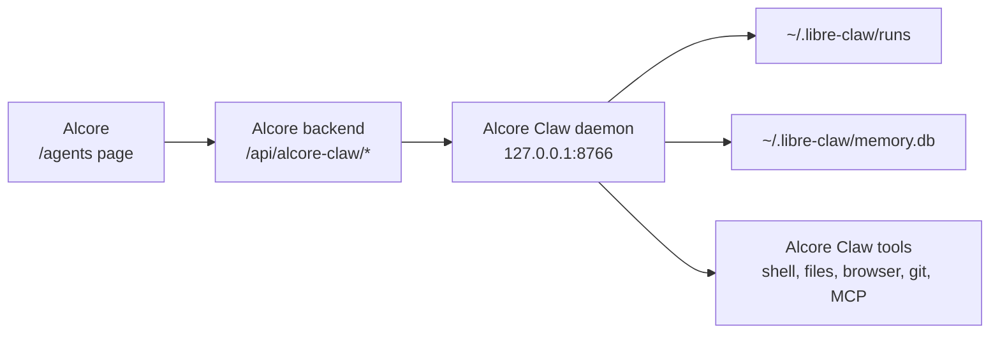

# Alcore Claw Integration

Alcore includes a native integration for
[Alcore Claw](https://github.com/kroonen-ai/libre-claw), Kroonen AI's local
agent harness. Alcore Claw is exposed as a first-class agent surface inside
Alcore rather than as a generic completion-provider plugin.

Alcore Claw remains the runtime that owns the powerful agent behavior:

- durable runs and JSONL event logs
- file, shell, git, browser, HTTP, web search, MCP, and schedule tools
- approval requests before side effects
- persistent memory and project/user skills
- goal mode
- fallback model routes
- usage reports
- daemon-owned automations and Telegram delivery
- the standalone local dashboard

Alcore talks to the Alcore Claw daemon over HTTP and exposes those features
inside the normal authenticated Alcore shell.

In the interface this surface is called **Agents** — the icon in the sidebar,
the `/agents` route, and the command palette entry all use that name. Alcore Claw
is the runtime behind it, so the daemon, its command, and its environment
variables keep their own name throughout this guide.

## Alcore Claw And Work Are Different

Alcore Claw remains an optional external runtime. It is not required for
Alcore's built-in **Work** mode.

|                         | Work                                                                   | Alcore Claw                                                                |
| ----------------------- | ---------------------------------------------------------------------- | ------------------------------------------------------------------------- |
| Runtime                 | Native Alcore model/tool loop plus Docker                         | Separate Alcore Claw daemon                                                |
| Primary scope           | One persistent, isolated coding workspace per task                     | Broader agent runs, memory, approvals, schedules, browser, MCP, and tools |
| Persistence             | SQLite task history plus a task-owned Docker named volume              | Alcore Claw's own run and memory stores                                    |
| Model routing           | Configured Alcore completion/chat plugin | Alcore Claw provider, model, and fallback configuration                    |
| Availability without it | Work continues normally                                                | Only the `/agents` Alcore Claw surface is disconnected                     |

Use Work when a model should build or modify files inside a constrained
task-scoped container. Use Alcore Claw when you need the daemon's broader tool
set, approval system, memory, goals, or automations.

## Architecture



The Alcore backend never runs shell commands or browser tools directly for Alcore Claw. It proxies authenticated admin requests to the local daemon and displays
the daemon's run state, events, approvals, automations, usage, and configuration.

## Start Alcore Claw

Install Alcore Claw:

```bash
git clone https://github.com/kroonen-ai/libre-claw.git
cd libre-claw
python3 -m venv .venv
source .venv/bin/activate
python -m pip install --upgrade pip
python -m pip install -e ".[dev]"
```

Start the daemon:

```bash
alcore-claw start
```

The default dashboard and API are available at:

```text
http://127.0.0.1:8766/dashboard
```

Then open **Alcore → Agents**.

## Backend Environment

Alcore uses the local daemon URL by default:

```bash
ALCORE_CLAW_BASE_URL=http://127.0.0.1:8766
ALCORE_CLAW_TIMEOUT_MS=30000
```

Set `ALCORE_CLAW_BASE_URL` if the daemon runs on another host, a Tailscale IP, or
a reverse-proxied local service.

## Alcore Routes

All Alcore Claw routes require an authenticated admin user because they can reveal
local file paths and trigger agent work:

| Alcore route                                             | Alcore Claw feature                     |
| ------------------------------------------------------- | -------------------------------------- |
| `GET /api/alcore-claw/status`                            | Daemon health, base URL, dashboard URL |
| `GET /api/alcore-claw/config/model`                      | Current provider/model                 |
| `PATCH /api/alcore-claw/config/model`                    | Update provider/model                  |
| `GET /api/alcore-claw/config/fallback`                   | Current fallback route                 |
| `PATCH /api/alcore-claw/config/fallback`                 | Update fallback route                  |
| `PATCH /api/alcore-claw/config/theme`                    | Update dashboard/TUI theme             |
| `GET /api/alcore-claw/runs`                              | List durable runs                      |
| `POST /api/alcore-claw/runs`                             | Start chat or goal-mode run            |
| `GET /api/alcore-claw/runs/:id`                          | Run metadata and artifacts             |
| `GET /api/alcore-claw/runs/:id/events`                   | Incremental run events                 |
| `POST /api/alcore-claw/runs/:id/cancel`                  | Cancel a run                           |
| `POST /api/alcore-claw/runs/:id/permissions/:toolCallId` | Approve or deny a tool call            |
| `GET /api/alcore-claw/usage`                             | Usage summary and records              |
| `GET /api/alcore-claw/automations`                       | List scheduled automations             |
| `POST /api/alcore-claw/automations`                      | Create automation                      |
| `PATCH /api/alcore-claw/automations/:id`                 | Update automation                      |
| `POST /api/alcore-claw/automations/:id/run`              | Run automation now                     |
| `POST /api/alcore-claw/automations/:id/pause`            | Pause automation                       |
| `POST /api/alcore-claw/automations/:id/resume`           | Resume automation                      |
| `DELETE /api/alcore-claw/automations/:id`                | Delete automation                      |

## Starting Runs

The Alcore page can start:

- **Chat runs** — normal Alcore Claw agent turns.
- **Goal runs** — bounded autopilot mode where Alcore Claw continues until its
  judge marks the goal complete or it reaches the configured limit.

Optional provider/model overrides are passed through to Alcore Claw for that run.
If omitted, Alcore Claw uses its configured default provider and model.

## Approvals

When Alcore Claw asks for permission, Alcore shows the pending tool call and lets an
admin choose:

- `allow_once`
- `deny`
- `always_allow_tool`

Alcore Claw still owns the permission model and safety checks. Alcore only records
the admin's choice through the daemon API.

## Automations

Alcore can create and manage Alcore Claw daemon automations:

- report automations
- Telegram-routed automations
- pause/resume
- run now
- delete

These are Alcore Claw automations, not host cron jobs. Reports and execution
history remain in Alcore Claw's run store.

## Memory, Skills, Soul, And Tools

Memory, skills, soul files, MCP tools, browser tools, SearXNG, Petdex, and
Telegram are configured in Alcore Claw itself. Alcore displays and controls the
daemon-facing features without duplicating Alcore Claw's internal configuration
system.

Useful Alcore Claw commands:

```text
/memory status
/skills list
/soul status
/tools list
/workspace status
/telegram
/petdex status
```

## Troubleshooting

### Alcore Shows "Alcore Claw daemon is not connected"

Start the daemon:

```bash
alcore-claw start
```

Or set the backend URL:

```bash
ALCORE_CLAW_BASE_URL=http://127.0.0.1:8766
```

### Permission Buttons Do Nothing

The run may have already finished or the permission may have been resolved from
another surface, such as the Alcore Claw dashboard or Telegram bridge. Refresh the
Alcore page and inspect the run timeline.

### A Tool Was Denied

Alcore Claw's permission manager is authoritative. Check Alcore Claw's own config
and run events if a call is denied before Alcore sees an approval request.

### Automations Do Not Run

Check Alcore Claw daemon status and automation config:

```bash
alcore-claw status
alcore-claw start
```

The daemon must be running for scheduled automations and Telegram delivery.

## Related Docs

- [Work: Isolated Workspaces](./WORKSPACES)
- [Authentication](./AUTHENTICATION)
- [Environment Variables](./ENVIRONMENT_VARIABLES)
